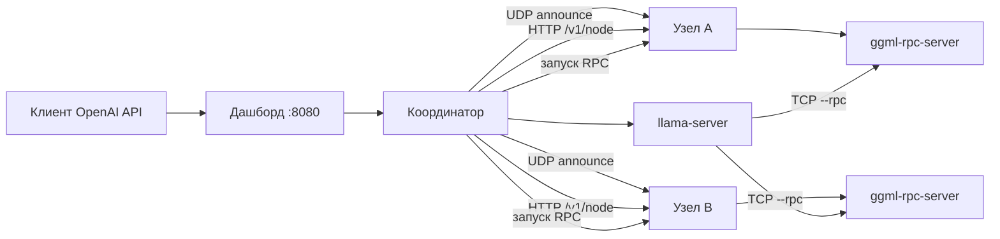

# fastagg

Программа собирает компьютеры в одной локальной сети и запускает на них **одну** модель. Каждый компьютер сообщает, чем он располагает. Координатор решает, как поделить слои, и поднимает готовый движок [llama.cpp](https://github.com/ggml-org/llama.cpp) с RPC-бэкендом.

Целевая система — Windows. Linux и macOS не отрезаны: определение ресурсов, имена архивов и запуск процессов разделены по ОС.

## Почему Python

Считает не наш код, а `llama.cpp`. Нам нужен процесс, который на Windows умеет:

- прочитать `nvidia-smi`, WMI и загрузчик Vulkan;
- найти соседние машины без ручного списка IP;
- скачать официальный архив и запустить его;
- отдать дашборд и OpenAI-совместимый HTTP.

Это удобно писать и проверять на Python 3.11+: `subprocess`, FastAPI, pytest. Тяжёлые тензоры живут в чужом процессе, поэтому язык оркестратора на скорость генерации не влияет. Позже тот же протокол можно упаковать в один exe.

## Почему llama.cpp RPC

У llama.cpp есть официальные Windows-сборки: CPU, CUDA 12.4, CUDA 13.5, Vulkan, ROCm, SYCL. На каждой машине `ggml-rpc-server` отдаёт свои устройства по TCP. На координаторе `llama-server --rpc` держит файл модели, режет её по слоям и сам говорит на OpenAI API.

[exo](https://github.com/exo-explore/exo) собирает кластер вокруг MLX и в первую очередь рассчитан на Apple Silicon. Для Windows с NVIDIA, AMD и Intel готовый путь — RPC llama.cpp. Свой рантайм для MVP не нужен.

Закреплена сборка **b12359** (llama.cpp 1.0.0, commit `b1b770d90`). У тега `v1.0.0` на GitHub нет бинарников, страница релиза указывает эту ночную сборку. Протокол RPC не согласует версии: на всех машинах должен быть один и тот же `--release`.

Слои идут конвейером (`--split-mode layer`). Дополнительные машины увеличивают память, в которую помещается модель. Один запрос по обычной сети от этого, как правило, не становится быстрее: на каждый токен есть обмен между машинами.

## Архитектура



1. На каждой машине работает узел. Раз в несколько секунд он шлёт короткий UDP-пакет в локальную сеть и по HTTP отдаёт полный снимок ресурсов.
2. Координатор слушает те же пакеты, опрашивает HTTP и держит список. Машину из другой подсети можно добавить как `host:port`.
3. Перед запуском координатор выбирает бэкенд и долю памяти.
4. На выбранных машинах поднимается `ggml-rpc-server`. На координаторе поднимается `llama-server`, который ходит к ним по `--rpc`.
5. Дашборд и `/v1/*` висят на координаторе. Запросы к API проксируются на локальный `llama-server`.

Файл GGUF лежит только на координаторе. Воркеры получают веса по RPC.

## Как делится модель

По умолчанию в план попадают только GPU.

- Для GPU берётся свободная VRAM минус запас (по умолчанию 512 МиБ). Если свободен объём неизвестен, берётся полный.
- Для CPU, если отмечены «CPU-узлы», берётся половина свободной ОЗУ.
- Эти мегабайты уходят в `--tensor-split`. llama.cpp сам нормует доли.
- Устройства называются `RPC0`, `RPC1`, … и передаются в `--device`, чтобы слои не осели на процессоре координатора.
- Флаг `--rpc` стоит раньше `--device`: иначе текущий llama.cpp ещё не знает имён RPC-устройств.
- Свой узел координатора в `--rpc` записан как `127.0.0.1`.
- Порядок машин — по имени. Несколько GPU одной машины идут одним RPC-адресом и несколькими числами в split, в том порядке, в каком их увидел датчик.

Порядок устройств внутри одной машины должен совпасть с тем, как их перечислит `ggml-rpc-server`. Для NVIDIA это порядок `nvidia-smi`. На машине с двумя GPU это пока предположение.

Выбор бэкенда, если не задан `--backend`:

| ОС | Порядок |
| --- | --- |
| Windows | CUDA, Vulkan, ROCm, SYCL, CPU |
| Linux | CUDA, ROCm, Vulkan, SYCL, CPU |
| macOS | Metal, дальше общий порядок |

На Windows Vulkan стоит выше ROCm: сборка Vulkan перекрывает AMD, Intel и NVIDIA одним архивом. CUDA по-прежнему предпочтительнее, когда `nvidia-smi` видит карту. Загрузчик Vulkan без единой карты бэкендом не считается.

Память NVIDIA читается из `nvidia-smi`. На Windows остальные карты берутся из `Win32_VideoController`. Поле `AdapterRAM` — это uint32 и упирается примерно в 4 ГиБ, такие значения мы выбрасываем. Если объём неизвестен, узел покажет карту, но не возьмёт её в план, пока не задан `--vram-mb`. На Linux объём AMD читается из sysfs (`mem_info_vram_total`), на macOS — из `system_profiler`.

## Требования

- Windows 10/11 x64. Имена архивов для arm64 уже есть, сам запуск на ARM не проверялся.
- Python 3.11 или новее, в установщике отмечен Add to PATH.
- Для NVIDIA — драйвер с `nvidia-smi`. По умолчанию качается CUDA 12.4. Если она не встаёт на новый драйвер, на узле укажите `--cuda-build 13.5`.
- Для AMD и Intel — драйвер с Vulkan (`vulkan-1.dll`).
- Сеть, где машины видят широковещательный UDP. Иначе остаётся ручной адрес.
- Место под архив: CPU около 25 МиБ, Vulkan около 38 МиБ, CUDA около 180–320 МиБ.

RPC llama.cpp без пароля и без шифрования. Запускайте его только в своей сети. В интернет эти порты не выставляйте.

## Установка

На каждой машине, в каталоге с репозиторием:

```powershell
py -3.12 -m venv .venv
.\.venv\Scripts\Activate.ps1
pip install -e .
fastagg scan
```

Если политика PowerShell не даёт активировать окружение:

```powershell
.\.venv\Scripts\python.exe -m fast_aggregation scan
```

`fastagg doctor --fetch` скачивает CPU-сборку закреплённого тега и проверяет, что у `llama-server` есть флаг `--rpc`.

## Две машины Windows

Ниже `DESKTOP-A` — координатор, он же участник расчёта. `DESKTOP-B` — второй узел. Имена любые.

На обеих машинах откройте входящие порты в частной сети:

```powershell
New-NetFirewallRule -DisplayName "fastagg-discovery" -Direction Inbound -Protocol UDP -LocalPort 45221 -Action Allow
New-NetFirewallRule -DisplayName "fastagg-node" -Direction Inbound -Protocol TCP -LocalPort 47000 -Action Allow
New-NetFirewallRule -DisplayName "fastagg-rpc" -Direction Inbound -Protocol TCP -LocalPort 50052 -Action Allow
New-NetFirewallRule -DisplayName "fastagg-dashboard" -Direction Inbound -Protocol TCP -LocalPort 8080 -Action Allow
```

На `DESKTOP-A` дашборд занимает 8080, поэтому правило узла 47000 там нужно только если вы запускаете отдельный `fastagg node`. RPC-порт координатора по умолчанию тоже 50052.

Координатор:

```powershell
fastagg coordinator --name DESKTOP-A
```

Второй компьютер:

```powershell
fastagg node --name DESKTOP-B
```

Откройте `http://DESKTOP-A:8080`. В таблице должны появиться обе машины: ОС, процессор, ОЗУ, видеокарты, бэкенды. Если второй машины нет, широковещание не дошло. Впишите её адрес, например `192.168.1.20:47000`, и нажмите «Добавить». Узнать адрес на B можно командой `ipconfig`.

В форме укажите GGUF **на диске A** либо репозиторий Hugging Face, например `ggml-org/gemma-3-1b-it-GGUF:Q4_K_M`. Нажмите «Запустить». Первый раз узлы скачают архив llama.cpp, это может занять несколько минут. Статус сменится на `running`, в журнале будет `listening`.

Проверка API с любой машины, которая видит A:

```powershell
curl http://DESKTOP-A:8080/v1/chat/completions `
  -H "Content-Type: application/json" `
  -d "{\"model\":\"local\",\"messages\":[{\"role\":\"user\",\"content\":\"Привет\"}]}"
```

Имя модели можно взять из `GET /v1/models`. База для Open WebUI и других клиентов: `http://DESKTOP-A:8080/v1`.

Остановка — кнопка «Остановить» или `POST /api/cluster/stop`. Она гасит `llama-server` и те RPC-процессы, которые поднял этот запуск.

### Полезные флаги

| Флаг | Где | Смысл |
| --- | --- | --- |
| `--backend cuda\|vulkan\|rocm\|sycl\|cpu\|metal\|auto` | узел и координатор | Чем считать на этой машине |
| `--cuda-build 12.4\|13.5` | узел с NVIDIA | Какой CUDA-архив качать |
| `--vram-mb 16384` | узел | Подставить объём, если датчик его не увидел |
| `--advertise 192.168.1.20` | оба | IP, который увидят соседи, если автовыбор ошибся |
| `--release b12359` | оба | Один и тот же тег на всём кластере |
| `--no-participate` | координатор | Не отдавать эту машину в план, только управлять |
| `--rpc-port`, `--discovery-port`, `--port` | оба | Если порт занят |

Координатор без своего GPU — нормальный режим: `--no-participate`. Модель и `llama-server` всё равно остаются на нём.

## Порты

| Порт | Протокол | Кто |
| --- | --- | --- |
| 45221 | UDP | объявления |
| 47000 | TCP | HTTP узла |
| 50052 | TCP | `ggml-rpc-server` |
| 8080 | TCP | дашборд и OpenAI API |
| 18080 | TCP | `llama-server`, только localhost |

## HTTP

Узел:

- `GET /health`
- `GET /v1/node` — ресурсы и состояние RPC
- `POST /v1/rpc/start` — тело `{"release":"b12359","backend":"cuda"}`
- `POST /v1/rpc/stop`

Координатор:

- `GET /` — дашборд
- `GET /api/state` — узлы, фаза, журнал
- `POST /api/plan` — план без запуска
- `POST /api/nodes` — тело `{"address":"192.168.1.20:47000"}`
- `DELETE /api/nodes/{id}` — убрать ручной узел
- `POST /api/cluster/start` — скачать сборки, поднять RPC и `llama-server`
- `POST /api/cluster/stop`
- `/v1/*` — прокси к `llama-server`, пока фаза `running`

Пример тела запуска:

```json
{
  "model_path": "D:\\models\\model.gguf",
  "ctx_size": 4096,
  "parallel": 1,
  "allow_cpu": false,
  "reserve_mb": 512
}
```

`model_path` и `hf_repo` взаимоисключающие. `parallel` по умолчанию 1, чтобы не раздувать KV-кэш на нескольких машинах.

## Разработка и тесты

```bash
python3 -m venv .venv
.venv/bin/pip install -e ".[dev]"
.venv/bin/pytest
```

На Linux-машине без Windows и без NVIDIA тесты проверяют:

- разбор `nvidia-smi`, JSON Win32, `vulkaninfo` и sysfs по зафиксированному выводу;
- живые CPU и ОЗУ через psutil;
- что ветка Windows вызывает PowerShell, а ветка Linux — нет;
- UDP: два сокета на `127.0.0.1` находят друг друга, битый пакет игнорируется, свой пакет не считается соседом;
- доли памяти, пропуск CPU, порядок `--rpc` раньше `--device`;
- имена архивов b12359, распаковку zip и отказ от пути с `..`;
- HTTP узла, ручное добавление, дашборд и отказ `/v1` до запуска.

## Что уже проверено

На этой Linux VM (Ubuntu 24.04, без GPU, 14 ноября 2026):

- `pytest`: 44 теста.
- `fastagg doctor --fetch` скачал `llama-b12359-bin-ubuntu-x64.tar.gz`. Версия: `1.0.0-dev (build 12359, commit b1b770d90)`. В `--help` есть `--rpc`, рядом лежит `ggml-rpc-server`.
- Два процесса на одной машине нашли друг друга по UDP и опросили HTTP. Дашборд показал оба узла.
- Через сам координатор поднят кластер из двух CPU RPC (`--device RPC0,RPC1`, `--tensor-split` поровну). Модель `stories260K.gguf` (1.2 МиБ, заголовок GGUF) загрузилась, `GET` здоровья `llama-server` ответил 200.
- `POST /v1/completions` и `POST /v1/chat/completions` на порту координатора вернули текст. Модель крошечная и без нормального чат-шаблона, поэтому ответ бессодержательный; важен сам прокси.
- В браузере открыт `http://127.0.0.1:8080`: статус `running`, в таблице `vm-coord` и `vm-worker`, кнопка «Показать план» ходит в API.

Порт 50052 на этой VM уже был занят чужим процессом. Узлы для прогона слушали 50152 и 50162. Если `ggml-rpc-server` не может занять порт, узел отдаёт его журнал, а не молча считает чужой сокет своим.

## Что на Windows не проверялось

Здесь не было машины с Windows и не было видеокарты.

- Установка Python, SmartScreen на скачанный exe, правила брандмауэра.
- `nvidia-smi`, WMI и реальный объём VRAM.
- Сборки CUDA, Vulkan, ROCm и SYCL, в том числе смесь разных бэкендов в одном кластере.
- Широковещание UDP между двумя физическими ПК. На одной машине оно сработало; автотест гоняет unicast.
- Большая модель и репозиторий Hugging Face через `--hf-repo`.
- Две GPU в одном `ggml-rpc-server` и совпадение порядка с `--tensor-split`.
- Запуск архива macOS Metal.

Следующий шаг — два Windows-компьютера с NVIDIA в одной подсети: `fastagg scan` на обоих, появление второго узла в дашборде без ручного IP, запуск GGUF, который не влезает в одну карту. Если карта AMD, тот же сценарий с `--backend vulkan`. После этого имеет смысл общий токен на HTTP и RPC, mDNS рядом с UDP и упаковка оркестратора в exe.
