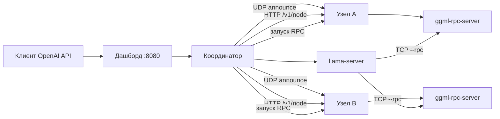

# fastagg

Программа собирает компьютеры в одной локальной сети и запускает на них **одну** модель. Каждый компьютер сообщает, чем он располагает. Координатор решает, как поделить слои, и поднимает готовый движок [llama.cpp](https://github.com/ggml-org/llama.cpp) с RPC-бэкендом.

Целевая система — Windows. Linux и macOS не отрезаны: определение ресурсов, имена архивов и запуск процессов разделены по ОС.

## Почему Python

Считает не наш код, а `llama.cpp`. Нам нужен процесс, который на Windows умеет:

- прочитать `nvidia-smi`, WMI и загрузчик Vulkan;
- найти соседние машины без ручного списка IP;
- скачать официальный архив и запустить его;
- отдать дашборд и OpenAI-совместимый HTTP.

Это удобно писать и проверять на Python 3.11+: `subprocess`, FastAPI, pytest. Тяжёлые тензоры живут в чужом процессе, поэтому язык оркестратора на скорость генерации не влияет. Позже тот же протокол можно упаковать в один exe.

## Почему llama.cpp RPC

У llama.cpp есть официальные Windows-сборки: CPU, CUDA 12.4, CUDA 13.5, Vulkan, ROCm, SYCL. На каждой машине `ggml-rpc-server` отдаёт свои устройства по TCP. На координаторе `llama-server --rpc` держит файл модели, режет её по слоям и сам говорит на OpenAI API.

[exo](https://github.com/exo-explore/exo) собирает кластер вокруг MLX и в первую очередь рассчитан на Apple Silicon. Для Windows с NVIDIA, AMD и Intel готовый путь — RPC llama.cpp. Свой рантайм для MVP не нужен.

Закреплена сборка **b12359** (llama.cpp 1.0.0, commit `b1b770d90`). У тега `v1.0.0` на GitHub нет бинарников, страница релиза указывает эту ночную сборку. Протокол RPC не согласует версии: на всех машинах должен быть один и тот же `--release`.

Слои идут конвейером (`--split-mode layer`). Дополнительные машины увеличивают память, в которую помещается модель. Один запрос по обычной сети от этого, как правило, не становится быстрее: на каждый токен есть обмен между машинами.

## Архитектура



1. На каждой машине работает узел. Раз в несколько секунд он шлёт короткий UDP-пакет в локальную сеть и по HTTP отдаёт полный снимок ресурсов.
2. Координатор слушает те же пакеты, опрашивает HTTP и держит список. Машину из другой подсети можно добавить как `host:port`.
3. Перед запуском координатор выбирает бэкенд и долю памяти.
4. На выбранных машинах поднимается `ggml-rpc-server`. На координаторе поднимается `llama-server`, который ходит к ним по `--rpc`.
5. Дашборд и `/v1/*` висят на координаторе. Запросы к API проксируются на локальный `llama-server`.

Файл GGUF лежит только на координаторе. Воркеры получают веса по RPC.

## Как делится модель

Планировщик считает вес каждого устройства и отдаёт эти веса в `--tensor-split`. llama.cpp сам нормует доли. Пока канал, температура и батарея неизвестны, вес равен свободной памяти — старое поведение. Как только замеры есть, вес меняется.

1. Узел выбрасывается, если он не в сети, перегрет (пакет или GPU от 92 °C), телефон на батарее ниже 35 % или ноутбук на батарее ниже 15 %.
2. Свободная VRAM уменьшается на запас 512 МиБ (на телефоне запас не меньше 1536 МиБ). Для CPU без GPU берётся половина свободной ОЗУ и только если отмечены «CPU-узлы»; у телефона эта доля не больше 35 %.
3. До запуска читается заголовок GGUF: размер файла плюс оценка KV по числу слоёв, ширине и контексту. Если сумма свободной памяти плана меньше, запуск отклоняется, а не начинается с нехваткой памяти.
4. Вес = память × температура/батарея/загрузка × сеть × класс устройства. Неизвестный канал не штрафуется. Известный сравнивается с 200 Мбит/с и 8 мс: Wi-Fi на 20 Мбит/с получает примерно десятую долю веса гигабитного узла. Если в кластере есть более быстрые машины и они вмещают модель, доля медленного канала дополнительно режется до 10 %, чтобы конвейер слоёв не ждал самый слабый линк. Если без него модель не влезает, доля сохраняется и в план пишется предупреждение.
5. Класс устройства: CUDA 1.0, ROCm и Metal 0.9, Vulkan 0.75, OpenCL 0.55, CPU 0.25 с поправкой на число ядер. Телефонный GPU дополнительно ×0.7.
6. Температура от 80 °C и высокая загрузка CPU снижают вес, но узел остаётся. Ноутбук от батареи ниже 40 % тоже получает меньшую долю.
7. Пока кластер работает, координатор следит за снимками. Пропажа узла или переход в «исключить» останавливает текущий `llama-server` и строит план заново. Если модель уже не помещается, кластер останавливается с текстом ошибки, а не падает по памяти. Таких автоматических перезапусков не больше трёх подряд. Троттлинг без исключения меняет следующий план и не рвёт уже идущую генерацию: перезагрузка модели дороже, чем дотерпеть запрос.

`--device RPC0,RPC1,…` не даёт слоям сесть на процессор координатора. `--rpc` стоит раньше `--device`. Свой узел координатора в `--rpc` записан как `127.0.0.1`. Порядок машин — по имени.

Порядок GPU внутри одной машины должен совпасть с `ggml-rpc-server`. Для NVIDIA это порядок `nvidia-smi`. На двух GPU одной машины это пока предположение.

Выбор бэкенда, если не задан `--backend`:

| ОС | Порядок |
| --- | --- |
| Windows | CUDA, Vulkan, ROCm, SYCL, CPU |
| Linux | CUDA, ROCm, Vulkan, SYCL, CPU |
| macOS | Metal, дальше общий порядок |
| Android | OpenCL (Adreno), CPU |

На Windows Vulkan стоит выше ROCm. Загрузчик Vulkan без единой карты бэкендом не считается.

Память NVIDIA читается из `nvidia-smi` вместе с температурой и загрузкой карты. На Windows остальные карты берутся из `Win32_VideoController`. `AdapterRAM` упирается примерно в 4 ГиБ, такие значения выбрасываются. Если объём неизвестен, карта видна, но в план не идёт, пока не задан `--vram-mb`. Температура на Linux берётся из `/sys/class/thermal` или psutil, на Windows парсер готов к WMI `MSAcpi_ThermalZoneTemperature` (десятые доли кельвина). Батарея и «от сети / от батареи» — через psutil, на телефоне в Termux класс устройства принудительно `phone`.

## Сеть: Ethernet, Wi-Fi и смесь

Обнаружение идёт тремя путями, от удобного к надёжному:

1. UDP broadcast на 45221. На одном коммутаторе этого хватает. На Wi-Fi multicast часто теряется.
2. Unicast-скан подсети не шире /24: `fastagg scan-net 192.168.1.0/24` или `POST /api/scan`. Координатор стучится TCP на порт узла. Это как раз случай «ноутбуки по Wi-Fi, ПК по кабелю» в одной домашней подсети, где роутер режет broadcast, но пускает обычные соединения.
3. Ручной адрес `host:port` и сопряжение по коду или ссылке `fastagg://`. QR этой ссылки отдаётся с localhost: `GET /api/pair/qr.svg`.

Изоляция клиентов на точке доступа режет и unicast. Тогда ни скан, ни broadcast, ни ручной IP с телефона не помогут, пока изоляцию не выключат.

После появления узла координатор меряет RTT по `GET /health` и пропускную способность по скачиванию 512 КиБ с `/v1/bench`. Цифры видны в таблице и входят в вес планировщика.

## Сопряжение

Координатор при первом запуске выпускает самоподписанный сертификат, токен кластера и код из 8 символов. Код можно вводить, пока его не сменят; пять ошибок подряд замораживают приём на 30 секунд.

На новом ПК, ноутбуке или в Termux:

```text
fastagg join --url "fastagg://АДРЕС:8080?code=КОД&fp=ОТПЕЧАТОК"
fastagg node
```

`join` открывает TLS, сравнивает отпечаток и только потом забирает токен. Узел присылает свой сертификат, координатор запоминает его и дальше ходит на узел по HTTPS с проверкой. UDP-объявления подписаны HMAC токена: чужой пакет в сети отбрасывается. `GET /health` публичный и не содержит ресурсов. Снимок ресурсов и запуск RPC требуют заголовок `Authorization: Bearer`.

Режим `--open` выключает токен и TLS. Это только для отладки на одном столе.

Поток тензоров llama.cpp RPC этот сертификат не закрывает. Шифруется управляющий HTTP. Для RPC в коде есть TLS-мост (`security/tunnel.py`), он проверен на локальном эхо, но в путь `llama-server` по умолчанию не вставлен: непроверенный прокси на живом RPC легко рвёт генерацию.

## Установка на Windows

Из корня репозитория в PowerShell:

```powershell
Set-ExecutionPolicy -Scope Process Bypass
.\scripts\install-windows.ps1 -Role Coordinator
```

На остальных машинах `-Role Node`. Скрипт создаёт `.venv`, ставит пакет, добавляет правила брандмауэра для частного профиля (UDP 45221, TCP 47000, 50052, 8080) и регистрирует задачу планировщика на вход пользователя. Это автозапуск без отдельной службы и без иконки в трее. Служба через NSSM возможна позже, в скрипте её нет.

Дальше на координаторе `fastagg coordinator`, на остальных — `join`, затем `node`.

## Телефон Android

Рабочий путь в этом репозитории — Termux, не отдельное приложение.

Официальные архивы llama.cpp b12359, проверенные по списку файлов:

- `llama-b12359-bin-android-arm64.tar.gz` — CPU, внутри есть `ggml-rpc-server` и `llama-server`.
- `llama-b12359-bin-android-arm64-snapdragon.tar.gz` — OpenCL и Hexagon для Adreno, `ggml-rpc-server` в `bin/`.

Отдельной Android-сборки Vulkan в этом релизе нет. Телефон на Mali считается через CPU-архив. Скрипт `scripts/termux-node.sh` ставит Python, смотрит `/sys/class/kgsl` и выбирает `opencl` или `cpu`, затем сопрягает узел.

Нативное приложение, которого здесь нет, имело бы смысл таким: экран сопряжения (камера читает QR), передний сервис с типом `dataSync`, тот же `ggml-rpc-server` из официального архива в своём процессе, уведомление с температурой и батареей, остановка при жаре и при заряде ниже порога. Пока этого APK нет, телефон подключается через Termux по инструкции выше.

## Требования

- Windows 10/11 x64. Имена архивов для arm64 уже есть, сам запуск на ARM не проверялся.
- Python 3.11 или новее, в установщике отмечен Add to PATH.
- Для NVIDIA — драйвер с `nvidia-smi`. По умолчанию качается CUDA 12.4. Если она не встаёт на новый драйвер, на узле укажите `--cuda-build 13.5`.
- Для AMD и Intel — драйвер с Vulkan (`vulkan-1.dll`).
- Общая подсеть с ПК по кабелю и ноутбуками по Wi-Fi. Изоляция клиентов на точке доступа должна быть выключена.
- Место под архив: CPU около 25 МиБ, Vulkan около 38 МиБ, CUDA около 180–320 МиБ, Android CPU около 76 МиБ, snapdragon около 63 МиБ.

Управляющий канал — HTTPS и токен. Поток RPC llama.cpp остаётся открытым TCP. В интернет эти порты не выставляйте.

## Установка

На каждой машине, в каталоге с репозиторием:

```powershell
py -3.12 -m venv .venv
.\.venv\Scripts\Activate.ps1
pip install -e .
fastagg scan
```

Если политика PowerShell не даёт активировать окружение:

```powershell
.\.venv\Scripts\python.exe -m fast_aggregation scan
```

`fastagg doctor --fetch` скачивает CPU-сборку закреплённого тега и проверяет, что у `llama-server` есть флаг `--rpc`.

## Две машины Windows

Ниже `DESKTOP-A` — координатор, он же участник расчёта. `DESKTOP-B` — второй узел. Имена любые.

На обеих машинах откройте входящие порты в частной сети:

```powershell
New-NetFirewallRule -DisplayName "fastagg-discovery" -Direction Inbound -Protocol UDP -LocalPort 45221 -Action Allow
New-NetFirewallRule -DisplayName "fastagg-node" -Direction Inbound -Protocol TCP -LocalPort 47000 -Action Allow
New-NetFirewallRule -DisplayName "fastagg-rpc" -Direction Inbound -Protocol TCP -LocalPort 50052 -Action Allow
New-NetFirewallRule -DisplayName "fastagg-dashboard" -Direction Inbound -Protocol TCP -LocalPort 8080 -Action Allow
```

На `DESKTOP-A` дашборд занимает 8080, поэтому правило узла 47000 там нужно только если вы запускаете отдельный `fastagg node`. RPC-порт координатора по умолчанию тоже 50052.

Координатор:

```powershell
fastagg coordinator --name DESKTOP-A
```

На `DESKTOP-A` в консоли появятся код из 8 символов, отпечаток сертификата и ссылка `fastagg://...`. Тот же код виден на дашборде, если открыть его **на самом A** (`https://127.0.0.1:8080`). С других компьютеров код по HTTP не отдаётся.

Второй компьютер, ноутбук или телефон сопрягается этой ссылкой. Без кода чужой узел в сети не входит в кластер: объявления подписаны HMAC, HTTP узла требует `Authorization: Bearer`.

```powershell
fastagg join --url "fastagg://192.168.1.10:8080?code=КОД&fp=ОТПЕЧАТОК"
fastagg node --name DESKTOP-B
```

`join` сверяет отпечаток TLS и только потом сохраняет токен. Если отпечаток не совпал, узел к координатору не подключается.

Дальше откройте `https://DESKTOP-A:8080` (браузер предупредит о самоподписанном сертификате — сверьте отпечаток). В таблице должны появиться обе машины. Если второй машины нет, широковещание по Wi-Fi часто не доходит. Тогда с координатора:

```powershell
fastagg scan-net 192.168.1.0/24
```

или впишите адрес вручную, например `192.168.1.20:47000`. Скан и ручной адрес — это unicast. Они работают, когда точка доступа режет multicast, но пускает обычные TCP между клиентами. Если на точке включена **изоляция клиентов**, телефон не достучится до ПК никаким способом, пока изоляцию не выключат или устройства не окажутся в одной сети без неё (обычный домашний роутер мостит Wi-Fi и Ethernet в одну подсеть — unicast при этом жив, broadcast нет).

В форме укажите GGUF **на диске A** либо репозиторий Hugging Face, например `ggml-org/gemma-3-1b-it-GGUF:Q4_K_M`. Нажмите «Запустить». Первый раз узлы скачают архив llama.cpp, это может занять несколько минут. Статус сменится на `running`, в журнале будет `listening`.

Проверка API с любой машины, которая видит A:

```powershell
curl -k https://DESKTOP-A:8080/v1/chat/completions `
  -H "Content-Type: application/json" `
  -d "{\"model\":\"local\",\"messages\":[{\"role\":\"user\",\"content\":\"Привет\"}]}"
```

Имя модели можно взять из `GET /v1/models`. База для клиентов: `https://DESKTOP-A:8080/v1`. Флаг `-k` у curl отключает проверку сертификата; отпечаток всё равно сверьте глазами. Управляющий HTTPS зашифрован. Поток весов llama.cpp RPC между машинами — обычный TCP без шифрования, его нельзя выпускать за пределы своей сети.

Остановка — кнопка «Остановить» или `POST /api/cluster/stop`. Она гасит `llama-server` и те RPC-процессы, которые поднял этот запуск.

### Полезные флаги

| Флаг | Где | Смысл |
| --- | --- | --- |
| `--backend cuda\|vulkan\|rocm\|sycl\|cpu\|metal\|auto` | узел и координатор | Чем считать на этой машине |
| `--cuda-build 12.4\|13.5` | узел с NVIDIA | Какой CUDA-архив качать |
| `--vram-mb 16384` | узел | Подставить объём, если датчик его не увидел |
| `--advertise 192.168.1.20` | оба | IP, который увидят соседи, если автовыбор ошибся |
| `--release b12359` | оба | Один и тот же тег на всём кластере |
| `--no-participate` | координатор | Не отдавать эту машину в план, только управлять |
| `--rpc-port`, `--discovery-port`, `--port` | оба | Если порт занят |
| `--open` | оба | Без токена и TLS, только лаборатория |
| `--insecure-http` | оба | Токен есть, TLS нет |

Координатор без своего GPU — нормальный режим: `--no-participate`. Модель и `llama-server` всё равно остаются на нём.

## Порты

| Порт | Протокол | Кто |
| --- | --- | --- |
| 45221 | UDP | объявления |
| 47000 | TCP | HTTP узла |
| 50052 | TCP | `ggml-rpc-server` |
| 8080 | TCP | дашборд и OpenAI API |
| 18080 | TCP | `llama-server`, только localhost |

## HTTP

Узел:

- `GET /health`
- `GET /v1/node` — ресурсы и состояние RPC
- `POST /v1/rpc/start` — тело `{"release":"b12359","backend":"cuda"}`
- `POST /v1/rpc/stop`

Координатор:

- `GET /` — дашборд
- `GET /api/state` — узлы, фаза, журнал
- `POST /api/plan` — план без запуска
- `POST /api/nodes` — тело `{"address":"192.168.1.20:47000"}`
- `DELETE /api/nodes/{id}` — убрать ручной узел
- `POST /api/cluster/start` — скачать сборки, поднять RPC и `llama-server`
- `POST /api/cluster/stop`
- `/v1/*` — прокси к `llama-server`, пока фаза `running`

Пример тела запуска:

```json
{
  "model_path": "D:\\models\\model.gguf",
  "ctx_size": 4096,
  "parallel": 1,
  "allow_cpu": false,
  "reserve_mb": 512
}
```

`model_path` и `hf_repo` взаимоисключающие. `parallel` по умолчанию 1, чтобы не раздувать KV-кэш на нескольких машинах.

## Консоль координатора

`fastagg coordinator --models-dir D:\models` открывает локальное приложение: обзор ёмкости, узлы, подбор моделей и чат. Страница одна, шрифты системные, внешних адресов в ней нет. История диалогов лежит в браузере на этом компьютере.

На вкладке «Узлы» можно подключить адрес, обойти подсеть, исключить машину из расчёта и задать ей потолок температуры, минимум батареи, запас и потолок памяти. На «Обзоре» видны сырая и пригодная память, медленный канал и какие слои на каком узле. «Модели» сравнивают 7B/13B/32B/70B в Q4, Q5 и Q8 с пригодной памятью: веса типичного GGUF, KV на выбранный контекст и 384 МиБ служебных буферов RPC. Рядом оценка ток/с: ориентир 40 ток/с для 7B Q4 на настольной CUDA, дальше масштаб по размеру, квантованию и самому медленному измеренному каналу. Это оценка, не бенчмарк. Локальные GGUF из `--models-dir` показывают, влезет ли конкретный файл и как лягут слои, до кнопки «Запустить».

Чат шлёт поток в `/v1/chat/completions`. Скорость берётся из поля `timings` ответа llama-server, когда оно есть.

## Полностью офлайн

По умолчанию ни координатор, ни узел не ходят в интернет за llama.cpp. Сборку кладут заранее:

```powershell
fastagg runtime-import D:\usb\llama-b12359-bin-win-cuda-12.4-x64.zip
```

Координатор отдаёт этот архив по `https://координатор:8080/runtime/<имя файла>` только узлам с токеном. После `fastagg join` узел запоминает этот адрес и берёт бинарник по локальной сети. Флаг `--allow-download` — единственный путь скачать архив с GitHub, и он выключен. Модели тоже только из локальной папки или с флешки. Hugging Face остаётся необязательным полем и без сети не сработает.

## Разработка и тесты

```bash
python3 -m venv .venv
.venv/bin/pip install -e ".[dev]"
.venv/bin/pytest
```

На Linux-машине без Windows и без NVIDIA тесты проверяют:

- разбор `nvidia-smi`, JSON Win32, `vulkaninfo` и sysfs по зафиксированному выводу;
- живые CPU и ОЗУ через psutil;
- что ветка Windows вызывает PowerShell, а ветка Linux — нет;
- UDP: два сокета на `127.0.0.1` находят друг друга, битый пакет и пакет с чужим HMAC отбрасываются;
- доли памяти, штраф медленному каналу, отсев перегрева и разряженного телефона, порядок `--rpc` раньше `--device`;
- заголовок GGUF, unicast-скан, TLS-мост на эхо, код сопряжения;
- имена архивов b12359, включая Android CPU и snapdragon, распаковку zip и отказ от пути с `..`;
- HTTP узла с токеном, ручное добавление, дашборд и отказ `/v1` до запуска;
- офлайн-сборка: без `--allow-download` GitHub не вызывается, локальный zip распаковывается; страница консоли не содержит внешних адресов; лимит узла и рекомендация 7B/70B проверяются на фикстуре.

## Что сделано и проверено на этой Linux VM

14 ноября 2026, Ubuntu 24.04, без GPU и без телефона:

- `pytest`: 62 теста.
- `fastagg doctor --fetch` скачал CPU-сборку b12359 (`1.0.0-dev`, commit `b1b770d90`) с `--rpc` и `ggml-rpc-server`.
- Два процесса нашли друг друга по UDP. Координатор поднял два CPU RPC на `stories260K.gguf`. `/v1/completions` и `/v1/chat/completions` вернули текст.
- В браузере дашборд показал оба узла и статус `running`.
- Списки файлов Android-архивов b12359 скачаны и просмотрены: CPU-архив и snapdragon содержат `ggml-rpc-server`. Сами бинарники на телефоне не запускались.

## Что реализовано, но не проверено на железе

- Скрипт установки Windows: брандмауэр и задача планировщика. На Windows он не запускался.
- WMI-температура, `nvidia-smi` с температурой и загрузкой, батарея ноутбука. Парсеры покрыты фикстурами, живого датчика не было.
- Unicast-скан по настоящей /24 и поведение Wi-Fi. Автотест стучится только в `127.0.0.1`.
- Сопряжение TLS между двумя машинами. Отпечаток и туннель проверены локальными сокетами.
- Скрипт Termux и выбор OpenCL по `/sys/class/kgsl`. На Android не запускался.
- Автоматическое перераспределение, когда узел пропадает в бою. Решение «кого снять» покрыто тестом, полный перезапуск llama-server из-за жары — нет.
- Оценка KV по настоящему большому GGUF. Тест кормит крошечный заголовок.

Оценка ток/с — формула от ориентира 40 ток/с для 7B Q4, не измерение на видеокарте. Консоль на `http://127.0.0.1:8091` открыта в браузере: вкладки обзора, узлов, моделей и чата на месте, локальный `stories260K.gguf` виден в списке, отправка сообщения без запущенной модели получает отказ, а не запрос в интернет. У процесса консоли в этот момент был только слушающий сокет на 127.0.0.1.

## Что только спроектировано

- Нативное Android-приложение с QR-камерой, foreground service и порогами батареи. Сейчас телефон — это Termux.
- Встройка TLS-моста в путь `llama-server --rpc`. Мост есть и гоняет байты, в оркестратор по умолчанию не включён.
- Служба Windows и иконка в трее. Есть задача на вход в систему.
- Шифрование самого RPC llama.cpp в рабочем запуске.
- mDNS, NSSM, проверка на двух физических ПК и на GPU.

Следующий шаг — два Windows-компьютера, один из них ноутбук по Wi-Fi: установка скриптом, `join` по коду, `scan-net`, если broadcast пустой, и GGUF, который не влезает в одну карту. Для телефона — тот же `join` из Termux на Adreno и на устройстве без kgsl.
